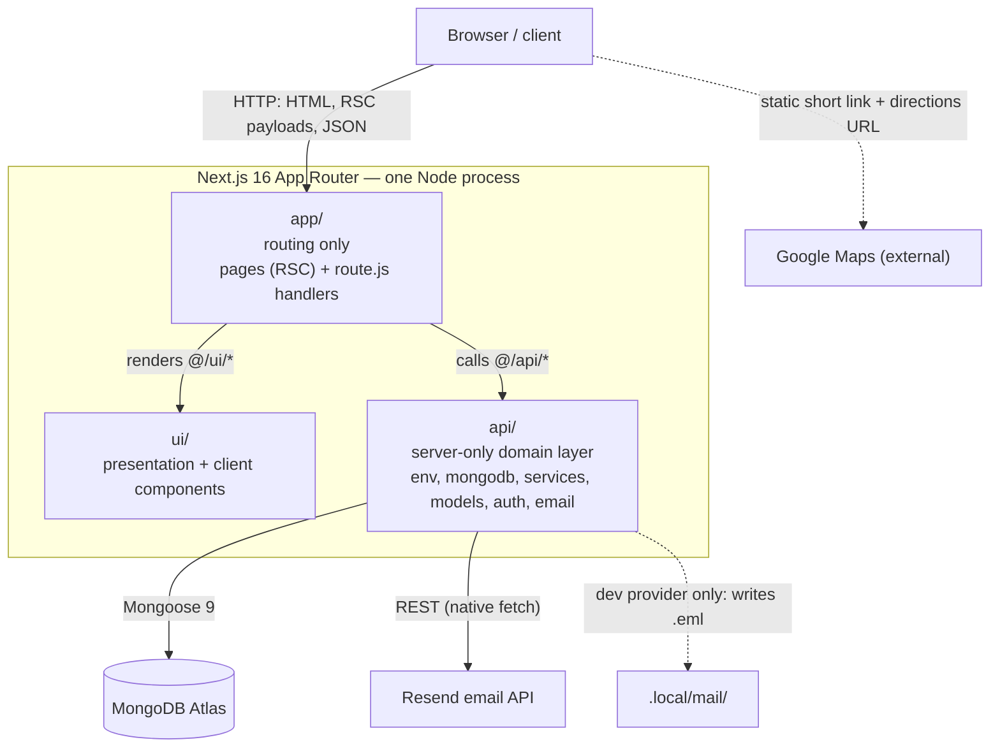
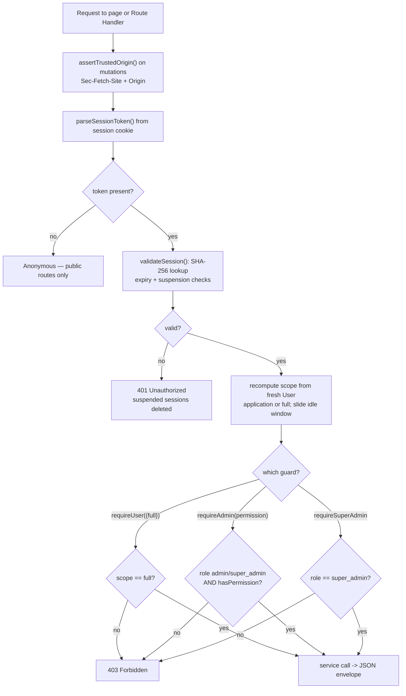
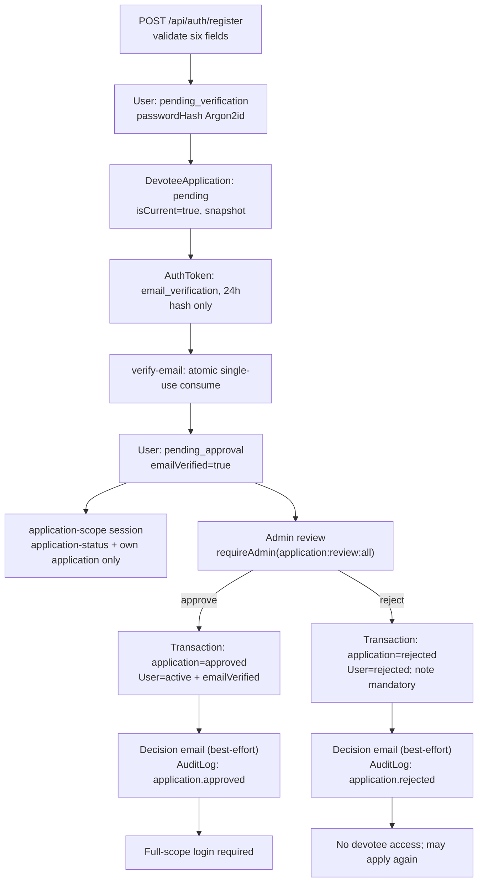
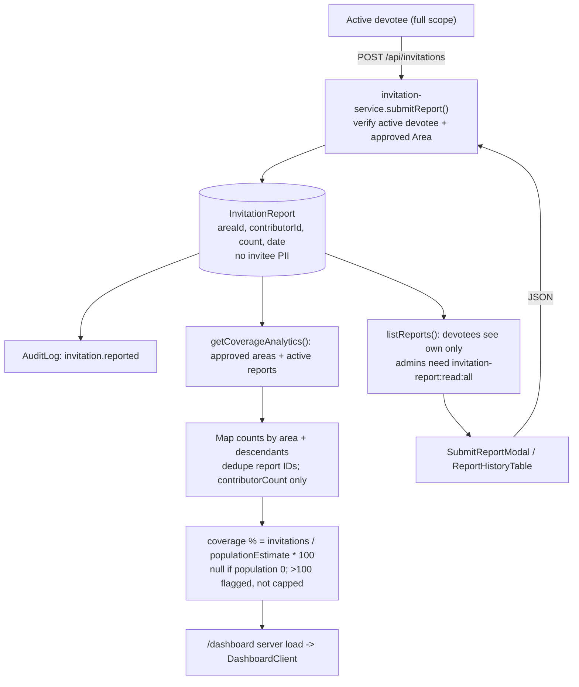
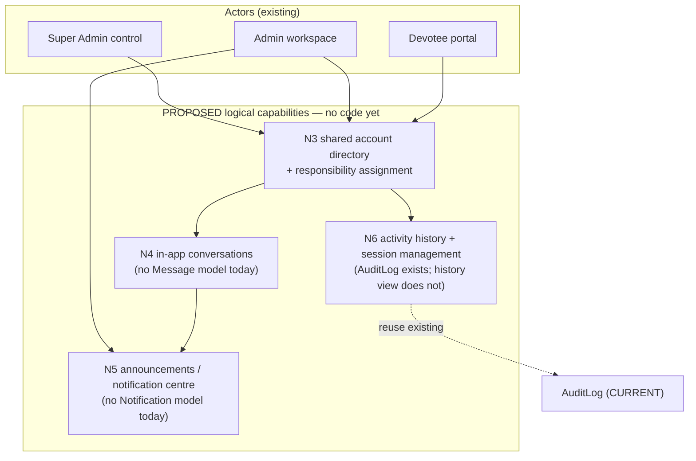

# Architecture

Last updated: 2026-11-17. This document describes what is **actually in the repository today** (CURRENT) and clearly separates **accepted but unimplemented ideas** (PROPOSED / FUTURE). It is written from verified source inspection; claims are not inferred from earlier design documents. For schema-level detail see [`database.md`](database.md), for rationale see [`decisions.md`](decisions.md), and for the original intentions see [`../06-history/original-roadmap.md`](../06-history/original-roadmap.md).

Two outcomes frame the system: help visitors find the Mahotsav venue, and let people apply to become devotees who, after approval, record campaign invitations. The official venue is **Kulti Golf Ground, Kulti, West Bengal, India**.

## Status legend

Use these labels consistently across the documentation set.

| Label                                       | Meaning                                                   |
| ------------------------------------------- | --------------------------------------------------------- |
| **Implemented and browser-verified**        | Real browser evidence exists.                             |
| **Implemented and automated-test verified** | Unit/integration coverage only.                           |
| **Implemented but inadequately tested**     | Code exists, without adequate automated or browser proof. |
| **Partially implemented**                   | Incomplete, unreachable, or missing key parts.            |
| **Designed but not implemented**            | Accepted design, no code.                                 |
| **Planned**                                 | Future intention.                                         |
| **Deprecated / superseded**                 | Historical only.                                          |

Unless a section says otherwise, CURRENT components are **Implemented and automated-test verified** or **Implemented but inadequately tested**; nothing in this document should be read as browser-verified without an explicit statement to that effect. The acceptance roadmap is in [`../roadmap.md`](../roadmap.md) and feature-by-feature status in [`../03-features/feature-status.md`](../03-features/feature-status.md).

## 1. High-level system architecture (CURRENT)

One Next.js 16 application serves both the user interface and the HTTP API from a single Node.js process. There is no Express server, no separate API package, no queue, no Redis, and no microservice. MongoDB Atlas is the only stateful dependency; email is an outbound adapter, not a source of truth.

### 1.1 Layer boundaries

| Directory  | Role                                                                                                      | May import                     | Must not import                                                                             |
| ---------- | --------------------------------------------------------------------------------------------------------- | ------------------------------ | ------------------------------------------------------------------------------------------- |
| `app/`     | Routing only. Pages compose `ui/`; `app/api/**/route.js` delegates to `api/`                              | `@/ui/*`, `@/api/*`            | —                                                                                           |
| `ui/`      | React components, hooks, client-safe helpers, global styles                                               | `@/ui/*`, `@/api/lib/app-info` | server-only modules (`api/lib/env`, `api/lib/mongodb`, `api/lib/logging`, models, services) |
| `api/`     | Server-only logic: env, logging, database, HTTP helpers, models, services, auth, email, privacy, security | `@/api/*`, npm packages        | `@/ui/*`, `@/app/*`                                                                         |
| `scripts/` | Node CLIs (super admin, index sync, DB inspection, config checks, prompt test)                            | load `.env.local` themselves   | bundled by Next                                                                             |
| `tests/`   | Vitest unit/integration, Playwright journeys, helpers, stubs                                              | anything                       | —                                                                                           |

Enforcement: `import "server-only"` appears on `api/lib/env`, `api/lib/mongodb`, `api/lib/logging`, all models and all services, so Next refuses to bundle them into a Client Component. `jsconfig.json` maps `@/*` to the repository root, and ESLint forbids relative `../api/*` imports so the boundary stays visible. See [`../01-project/conventions.md`](../01-project/conventions.md).

## 2. Technology stack (CURRENT)

| Concern          | Choice                                                                  |
| ---------------- | ----------------------------------------------------------------------- |
| Framework        | Next.js 16.4.6, App Router                                              |
| UI runtime       | React 19.3.0; JavaScript/JSX **only** (strict: `npm run check:js-only`) |
| Data             | Mongoose 9.11.4 against MongoDB Atlas                                   |
| Validation       | Zod 4.6.7 (request bodies and environment)                              |
| Styling / motion | Tailwind CSS 4 via `@tailwindcss/turbopack`, framer-motion              |
| Utilities        | libphonenumber-js, `@node-rs/argon2` (Argon2id)                         |
| Tests            | Vitest 4.1.12 (unit/integration), Playwright 1.65 (browser journeys)    |

There is no `tsconfig*.json`, no `next-env.d.ts`, and no TypeScript anywhere. `next.config.mjs` sets `reactStrictMode`, `poweredByHeader: false`, a Turbopack Tailwind rule, baseline security headers on all routes, and `no-referrer` + `no-store` on `/reset-password`, `/accept-invitation` and `/verify-email`. There is no Content-Security-Policy and no HMR watch exclusion (a historical ADR claim about such an exclusion is **Deprecated / superseded** — it is not in the working tree).

## 3. Next.js App Router structure (CURRENT)

Pages are Server Components; data-heavy pages delegate to Client Components under `ui/`. `app/error.jsx` is the only client component under `app/`. There are two layouts (root and the admin gate) and a thin set of route files.

| Area    | Routes                                                                                                                                                | Notes                                                                                                                                                                                                     |
| ------- | ----------------------------------------------------------------------------------------------------------------------------------------------------- | --------------------------------------------------------------------------------------------------------------------------------------------------------------------------------------------------------- |
| Public  | `/`, `/about`, `/map`, `/apply`, `/login`, `/verify-email`, `/reset-password`, `/accept-invitation`, `/application-status`                            | `/login` redirects to `/apply?mode=login`; `/map` is a **static venue page**, not an interactive campaign map                                                                                             |
| Devotee | `/dashboard`                                                                                                                                          | Server loads `listReports`, `listApprovedAreas`, `listProposals`, `getCoverageAnalytics`; redirects anonymous users to `/apply?mode=login`, admins to `/admin`, non-active users to `/application-status` |
| Admin   | `/admin`, `/admin/applications`, `/admin/applications/[id]`, `/admin/areas`, `/admin/proposals`, `/admin/invitations`, `/admin/audit`, `/admin/users` | `app/admin/layout.jsx` is a server-side gate                                                                                                                                                              |

### 3.1 Frontend architecture: RSC vs client components

Server Components own data loading and authorization-sensitive redirects; they render a safe projection into client components. Client components (`ui/components/**`) own interactivity — forms, modals, tables, the mobile navigation toggle, session provider — and call Route Handlers over JSON. They never receive password hashes, session hashes, internal review notes, or another devotee's identity. Shared UI primitives live in `ui/components/ui/`; feature groupings live under `account/`, `admin/`, `dashboard/`, `home/`, `invitations/`, `layout/`, `maps/`, `providers/` and `venue/`.

**Orphaned UI (Partially implemented):** `InteractiveMapClient`, `MapWorkspace`, `GoogleMapCanvas`, `SvgAtlas`, `AreaDetailsDrawer`, `AreaDetailsPanel`, `AreaListView`, `MapFallbackViewer`, `CampaignPulse` and `MapTeaser` are wired in code but no page imports them. The interactive map, area-details views, and public live statistics therefore exist in source but are unreachable. This is an acceptance gap for the devotee portal, not a rendering defect.

### 3.2 Caching and segment configuration

Next 16 Cache Components are not enabled. Pages are static by default; Route Handlers set `export const dynamic = "force-dynamic"` and every JSON response carries `Cache-Control: no-store`. Sensitive pages additionally set `no-referrer`.

## 4. Server-side architecture (CURRENT)

### 4.1 Services and models

`api/services/*` own multi-step workflows; models own schema, indexes and the only hooks in the system. Services call `connectToDatabase()` themselves, so Route Handlers stay thin.

| Service                  | Responsibility                                                                 |
| ------------------------ | ------------------------------------------------------------------------------ |
| `auth-service.js`        | Login/logout, session validation, token consumption, password reset            |
| `application-service.js` | Application submission, email verification, resend, own-application projection |
| `admin-service.js`       | Application approve/reject, administrator management, user status changes      |
| `area-service.js`        | Approved-area CRUD and hierarchy queries                                       |
| `proposal-service.js`    | Locality proposal submission and review                                        |
| `invitation-service.js`  | Report submission, review, listing, coverage analytics                         |

Nine Mongoose models exist; there is no migrations directory. All use the `mongoose.models.X || mongoose.model(...)` guard, no explicit collection names, no `strict: "throw"`, and no soft-delete plugin.

| Model                | Key shape / status                                                                                                                                                                                                                              |
| -------------------- | ----------------------------------------------------------------------------------------------------------------------------------------------------------------------------------------------------------------------------------------------- |
| `User`               | Unique email; `emailVerified`; `passwordHash` (`select:false`); role `devotee`/`admin`/`super_admin`; status `pending_verification`/`pending_approval`/`active`/`rejected`/`suspended`/`invited`; `adminPermissions: [String]` (no schema enum) |
| `Session`            | Unique `tokenHash`; `scope` `application`\|`full`; idle + absolute expiry; TTL on `expiresAt` (0s); no `revokedAt`                                                                                                                              |
| `AuthToken`          | Unique `tokenHash`; optional userId; type `email_verification`\|`password_reset`\|`admin_invitation`; TTL 0s; `usedAt`, `metadata`                                                                                                              |
| `RateLimit`          | Unique `key`, `count`, `expiresAt` with 60s TTL, `timestamps:false`                                                                                                                                                                             |
| `DevoteeApplication` | `userId`, applicant snapshot fields (no immutability hook), status `pending`/`approved`/`rejected`, `isCurrent`, `reviewedBy`/`reviewedAt`, embedded `reviewNote` string                                                                        |
| `Area`               | Flexible tree (`parentId`, `ancestorIds`), `type` (free-form), status `approved`/`archived`, `placeId`, GeoJSON `location` + `boundary`, `populationEstimate`, compound indexes                                                                 |
| `LocalityProposal`   | Proposal snapshot, status pending/needs_correction/approved/rejected/duplicate/withdrawn, `duplicates[]`, `approvedAreaId`                                                                                                                      |
| `InvitationReport`   | `areaId`, `contributorId`, `invitationCount >= 1`, `reportDate`, status active/flagged/invalid, `adminNotes`; no invitee PII                                                                                                                    |
| `AuditLog`           | Append-only event record; `createdAt` only; see §14                                                                                                                                                                                             |

Design-only models are **absent** (Designed but not implemented): `devoteeApplicationNotes`, `populationRecords`, `areaAssignments`, `notifications`, `systemSettings`. See [`database.md`](database.md).

## 5. API organization (CURRENT)

Every Route Handler follows the same thin pattern, illustrated by `POST /api/admin/applications/[id]/review`:

1. `assertTrustedOrigin(request)` — CSRF check on mutations.
2. `requireAdmin(request, ADMIN_PERMISSIONS.APPLICATION_REVIEW_ALL)` — guard.
3. Optional `enforceRateLimit(...)` keyed by `clientAddress(request)`.
4. Zod `parse()` of the JSON body.
5. One service call.
6. `jsonSuccess(...)` or `errorToResponse(error)`.

The **envelope** is `{ success: true, data }` or `{ success: false, error: { code, message, details? } }`, always with `no-store`. `errorToResponse` maps `ZodError → 400 VALIDATION_ERROR`, `AppError → its status`, duplicate key → `409 CONFLICT`, `DatabaseUnavailableError → 503`, and anything else → `500 INTERNAL_ERROR` with a generic message; raw driver errors never reach clients.

CSRF is per-route rather than middleware: `assertTrustedOrigin` rejects `Sec-Fetch-Site: cross-site` and any `Origin` outside `APP_BASE_URL`/request origin, but requests with **no Origin header are allowed** (curl, probes). There is no `middleware.js`; Server Components and Route Handlers are the only authorization boundary. See [`../04-quality/security.md`](../04-quality/security.md).

Admin workspace additions (Phase B): `GET /api/admin/accounts`, `GET /api/admin/accounts/:id` (both `devotee:read:all`) and `PATCH /api/admin/accounts/:id/status` (`devotee:status:update`, reason required, session revocation on suspend, audit `admin.devotee.status_updated`). Audit and invitation report GET routes gained server-side filters for actor/event/target/date and date range respectively. Population updates reuse `PATCH /api/admin/areas/:id` under `area:manage` rather than a new endpoint; Analytics reuses `getCoverageAnalytics()` and `listReports()`. `devotee:delete` is a distinct, opt-in permission for permanent deletion; `devotee:status:update` remains limited to suspension/reinstatement. No models were introduced for this change.

## 6. MongoDB Atlas connectivity (CURRENT)

`api/lib/mongodb/connection.js` caches the connection promise on `globalThis` to survive dev hot reload, uses short selection/connect timeouts and `bufferCommands: false`, and throws `DatabaseUnavailableError` on failure (logged server-side only). Environment values are validated lazily by `getEnv()` (Zod), so `next build` succeeds without a database while the first server use fails fast with variable names only.

`MONGODB_URI` targets the pilot database `utsav_connect_pilot`; `MONGODB_URI_TEST` targets `utsav_connect_test`. The names differ, and the test name ends in `_test` — test configuration refuses any other name. Credentials and URIs live only in `.env.local` and are never logged or committed. A 2026-11-17 read-only pilot snapshot showed 2 users, 1 approved application, 33 audit logs, 3 auth tokens, 1 session, and zero areas, proposals and reports — the campaign hierarchy and reporting collections are effectively empty in the pilot.

**Known gap:** `scripts/sync-indexes.js` covers only 7 of 9 models (it omits `RateLimit` and `InvitationReport`) and uses `syncIndexes()`, which can **drop** indexes. It must not be treated as a safe/non-destructive operation.

## 7. Authentication architecture (CURRENT)

- **Sessions:** 32 random bytes, base64url; only the SHA-256 hash is stored. Cookie `session=<token>; Path=/; HttpOnly; SameSite=Lax`, with `Secure` only in production — no `__Host-` prefix and no explicit `Max-Age`. Idle expiry 7 days, absolute 30 days, enforced again on validation; TTL on `expiresAt`.
- **Validation:** rejects expired/suspended sessions, deletes suspended sessions, recomputes scope from the current database user, and slides the idle window. Suspension and password-reset confirmation delete all sessions; self-edit and demotion/suspension of the last active Super Admin are blocked.
- **Login:** timing-equalised with a dummy Argon2id hash; checks verified email, suspended state and a status allowlist. Argon2id uses 19 MiB, t=2, p=1.
- **Tokens:** `AuthToken` stores hashes only. Email verification 24h (resend invalidates old tokens); password reset 24h (does **not** invalidate older reset tokens); admin invitation 7 days.
- **Rate limits:** login account 10/15m and IP 50/15m; register IP 5/h; password-reset request IP 5/h and email 3/h; verify IP 20/15m; resend IP/email 3/5m; application review IP 20/5m. Client IP comes from `x-forwarded-for`/`x-real-ip`, which is spoofable without a trusted proxy. Password-reset confirm and admin-invitation acceptance are not rate limited.

**Known defect (open, P0):** `api/services/auth-service.js` calls `logger.warn/info/error` in `requestPasswordReset` but never imports `logger`. When email is unavailable or delivery fails, the handler throws a 500 and can leak account existence. Tracked with the other stabilization items in [`../roadmap.md`](../roadmap.md).

## 8. Authorization and permission enforcement (CURRENT)

Roles are `devotee`, `admin`, `super_admin`; a **visitor** is the absence of a session, and an **applicant** is an `application`-scope session, not a stored role. `ADMIN_PERMISSIONS` declares ten strings: `application:read:all`, `application:review:all`, `application:note:write`, `devotee:read:all`, `devotee:status:update`, `devotee:delete`, `invitation-report:read:all`, `audit:read:all`, `area:manage`, `proposal:review`. `hasPermission` grants Super Admin everything, checks the array for admins, and denies everyone else; `requireAdmin` additionally enforces full scope and admin role. All `/api/admin/users/**` routes are Super Admin-only.

**Permission enforcement:** `devotee:read:all`, `devotee:status:update`, `devotee:delete` (service-level) and `canManageUser()` are enforced. `application:note:write` is enforced by a dedicated note endpoint; decisions no longer carry notes. `MODERATOR_PERMISSIONS` is an unused export. The former credential-registry status-sync defect in `app/api/admin/users/[id]/route.js` is fixed (the change is captured before assignment).

## 9. Application approval lifecycle (CURRENT)

Approve and reject each use a MongoDB transaction spanning the application and user updates; the decision email and audit record are written after commit, so a delivery failure never rolls back a decision. The internal review note is a string embedded on the application (there is no notes collection) and is never exposed to the applicant. By contrast, **locality-proposal approval is not transactional** (known gap). Product intent and open policy questions are in [`../01-project/product-requirements.md`](../01-project/product-requirements.md).

## 10. Email transport architecture (CURRENT)

`api/lib/email/transport.js` selects a provider from `EMAIL_PROVIDER`:

| Provider | Behaviour                                                                                                                                  |
| -------- | ------------------------------------------------------------------------------------------------------------------------------------------ |
| `dev`    | Writes `.eml` files into `.local/mail/`; never sends. `isEmailAvailable()` returns true, so flows complete locally without external email. |
| `resend` | Native `fetch` to the Resend REST API using `EMAIL_API_KEY` and `EMAIL_FROM`.                                                              |

There is **no SMTP transport** in code — a historical ADR claim about SMTP is wrong. `api/lib/email/adapter.js` exposes typed sends (verification, application notification/decision, password reset, admin invitation), all returning `{ accepted, error? }` and never throwing for delivery failures; tokens are never logged. Emails are sent for verification, verification resend, password reset, admin invitation and application decisions. **No email** is sent on direct user creation, suspend/reinstate, or proposal/report review (gaps). `AUTH_SECRET` is required by environment validation but is unused in code. See [`../05-operations/deployment.md`](../05-operations/deployment.md) for operator configuration.

## 11. Google Maps integration (CURRENT)

`ui/lib/venue.js` is the single source of truth for the venue: it holds the owner-supplied official short link `https://maps.app.goo.gl/BcY87xSjA6iRtBY78` and a **name-based** directions URL for "Kulti Golf Ground, Kulti, West Bengal". No coordinates or Place ID are invented, and the short-link destination has not been independently resolved. Satsang Ashram Deoghar is a separate place and is never presented as the venue.

Area models store optional `placeId`, `formattedAddress`, GeoJSON `location` and `boundary` fields, but there is **no server-side Places or Geocoding integration**. `GOOGLE_MAPS_SERVER_API_KEY` appears only in `.env.example`, not in the validated environment schema or any service. The interactive map components read `NEXT_PUBLIC_GOOGLE_MAPS_API_KEY` but are orphaned (§3.1), so the only reachable Maps behaviour is the static venue link and directions buttons. See [`../04-quality/security.md`](../04-quality/security.md) for key exposure notes.

## 12. Geographic hierarchy (CURRENT)

`Area` models an open-ended tree — Region → Town → Locality → Block, with free-form `type` rather than an enum. `parentId` plus a materialised `ancestorIds` array express ancestry; `status` is `approved` or `archived`. `location` (Point) and `boundary` (Polygon/MultiPolygon) have sparse 2dsphere indexes; compound indexes cover hierarchy and duplicate lookups. `LocalityProposal` is the intake path: devotees propose areas, admins review and may mark duplicates or corrections, and approval creates/points to an `Area`.

**Known gap:** `LocalityProposal.boundary` has **no 2dsphere index**, unlike `Area.boundary`. Proposal approval is not transactional. Index synchronisation is incomplete and potentially destructive (§6).

## 13. Campaign and invitation reporting (CURRENT)

Reports carry only `invitationCount`, `reportDate`, `description` and status — no participant count, invitee names, phones or emails. Devotees see only their own reports; administrators with `invitation-report:read:all` (or Super Admin) can read all and review/flag/invalidate (invalid requires a note). Aggregates are computed by walking `ancestorIds`/children, counting each descendant report once, and returning counts plus coverage status never contributor identities. Because `Area` documents are currently empty in the pilot, coverage rendering has no populated data there. Browser verification of coverage rendering is **not claimed**. See [`../03-features/feature-status.md`](../03-features/feature-status.md).

## 14. Audit logging (CURRENT)

`AuditLog` is append-only at the application level: pre-hooks reject updates and deletes, with a bypass only under `NODE_ENV=test` so integration fixtures can clean up. Records carry `eventType`, `actorId`, `actorRole`, a polymorphic `targetId`/`targetType`, non-PII `metadata`, `ipHash`, `userAgent` and `createdAt` only. **Immutability is application-level only** — Atlas shared tiers cannot express per-collection update/delete denial, so a direct database write could still alter records. Audit creation accompanies submission, verification, review, reporting, user changes and password reset; review notes are redacted in metadata.

## 15. Local development architecture (CURRENT)

`.env.local` (git-ignored) supplies validated configuration via `getEnv()`; `.env.example` documents variable names with safe placeholders. The `dev` email provider writes to `.local/mail/`, and local test credentials may optionally be written to a git-ignored credential registry under explicit flags (`STORE_CREDENTIALS_FOR_ALL_USERS` and role switches) — plaintext passwords are only stored in dev under those flags. Temporary artifacts belong under `.local/`. Make targets provide `dev`, `build`, `check`, `test-unit`, `test-integration`, `check-email`, `show-mail`, `check-health`, DB inspection and super-admin recovery; no target starts or points tests at a non-`_test` database. `docs/` was reorganised from root-level files; historical documents are preserved under `docs/06-history/`.

## 16. Testing architecture (CURRENT)

| Layer                | Status                                      | Notes                                                                                                                                           |
| -------------------- | ------------------------------------------- | ----------------------------------------------------------------------------------------------------------------------------------------------- |
| Unit (Vitest)        | **Implemented and automated-test verified** | 167 tests in 11 files                                                                                                                           |
| Integration (Vitest) | **Implemented and automated-test verified** | 120 tests in 12 files; all `describe.skipIf(gate.skip)`, gate enforces `_test` DB suffix, skips if unreachable unless `UTSAV_TEST_REQUIRE_DB=1` |
| `npm run check`      | **Implemented and automated-test verified** | js-only + lint + format + unit                                                                                                                  |
| Playwright journeys  | **Implemented but inadequately tested**     | Spec with 23 `test()` declarations (~31 logical after a 3-size loop) across 9 describes                                                         |

Vitest runs in the `node` environment with the `@/` alias, a `server-only` stub, a `.env.local` loader and `fileParallelism: false`. Playwright uses `playwright.config.mjs` with desktop (Desktop Chrome), tablet (iPad Air) and mobile (Pixel 7) projects, `baseURL` `localhost:3000`, an HTML reporter, and **no `webServer`** — the server must already be running. Coverage includes public pages, login, one dashboard report submission, admin headings, access/link hiding, venue buttons and a responsive drawer; it does **not** perform real approve/reject, area CRUD, proposal review, password reset, email verification, invitation acceptance or coverage rendering browser checks.

**Open defects (test infrastructure):** the Playwright spec hard-codes seeded accounts/password, but the seed lives in a git-ignored `.local/seed-test.mjs`; there is no committed seed and no `test:e2e` script or Make target. A committed failure artifact exists for `super@utsav.test` sign-in. The latest claimed results (2026-11-16 checkpoint) were `npm run check`, integration and build passing with no React key warnings; these were reported by a prior session and were **not re-run** during this documentation task. See [`../04-quality/testing.md`](../04-quality/testing.md).

## 17. Known defects and architectural gaps (open)

| ID  | Area          | Impact                                                                                                                                                                                |
| --- | ------------- | ------------------------------------------------------------------------------------------------------------------------------------------------------------------------------------- |
| D1  | Auth service  | Missing `logger` import → 500 and possible account enumeration on email failure (§7)                                                                                                  |
| D2  | E2E seed      | Hard-coded seeded accounts, no committed seed, no `make test-e2e`, committed failure artifact (§16)                                                                                   |
| D3  | Index sync    | Covers 7/9 models; `syncIndexes()` can drop indexes (§6)                                                                                                                              |
| D5  | Admin users   | Status guard always false → credential-registry status never syncs (§8)                                                                                                               |
| —   | Authorization | One declared-but-unenforced permission (`application:note:write`) and unused `MODERATOR_PERMISSIONS` export (§8)                                                                      |
| —   | CSRF          | Per-route checks only; no middleware; Origin-less requests allowed (§5)                                                                                                               |
| —   | Maps          | Interactive map UI orphaned; no server Places/Geocoding; short link unresolved (§3.1, §11)                                                                                            |
| —   | Audit         | Immutability application-level only (§14)                                                                                                                                             |
| —   | Data model    | No messaging/notification/system-settings models; no notes collection (§4.2)                                                                                                          |
| —   | Misc          | Registration enumeration (409); multiple reset tokens; proposal approval not transactional; cookie hardening and IP-spoofing gaps; public health exposes version; documentation drift |

None of these are resolved in this document; they feed Workstream A stabilization in [`../roadmap.md`](../roadmap.md).

## 18. PROPOSED / FUTURE — shared communication architecture

> **PROPOSED / FUTURE — NOT IMPLEMENTED.** Everything in this section is **Designed but not implemented** or **Planned**. No queues, microservices, Redis, external brokers, or new infrastructure are implied. The current system has no messaging or notification models and no server-side event bus; this diagram shows _logical capability boundaries_ only.

Product intent calls for shared capabilities beyond the campaign core: an account directory, in-app conversations, announcements, a notification centre, activity history, session management and audit. Today **only audit exists**; the rest are missing and must be designed before implementation. New capabilities depend on completing the existing product (Workstream A) first.

Dependency order (from [`../roadmap.md`](../roadmap.md)): Workstream A phases precede N1–N7; N1 (account lifecycle) → N2/N3; N3 → N4; N4 plus domain events → N5; N6 runs in parallel after A; N7 (retention) requires an approved retention policy and Phase E. A feature must not be scheduled before its prerequisites. Any future event or delivery mechanism is a design decision to be recorded in [`decisions.md`](decisions.md), not an assumption to be built on now.

## 19. Related documents

- [`database.md`](database.md) — schema and index reference
- [`decisions.md`](decisions.md) — architecture decision records
- [`../01-project/product-requirements.md`](../01-project/product-requirements.md) — product intent and open questions
- [`../01-project/conventions.md`](../01-project/conventions.md) — layering and coding conventions
- [`../03-features/feature-status.md`](../03-features/feature-status.md) — feature-level status
- [`../04-quality/security.md`](../04-quality/security.md) — security posture
- [`../04-quality/testing.md`](../04-quality/testing.md) — test plan and evidence
- [`../roadmap.md`](../roadmap.md) — current acceptance roadmap
- [`../06-history/original-roadmap.md`](../06-history/original-roadmap.md) — historical intentions (Deprecated / superseded where contradicted here)

## Stabilization pass (2026-11-18)

Local runtime artifacts are anchored to the discovered project root via `api/lib/paths/local-artifacts.js`. Permanent deletion is gated by `api/lib/policies/account-deletion-policy.js` (currently `false`). Audit reads project an allowlist; new IP hashes use `api/lib/privacy/ip-hash.js` (keyed HMAC, `v1:` prefix). The last-active-Super-Admin rule lives in `api/lib/auth/super-admin-policy.js` and is unit-tested. `tests/unit/admin-route-guard-registry.test.js` enumerates every `app/api/admin/**/route.js` via AST and fails on missing guards.
